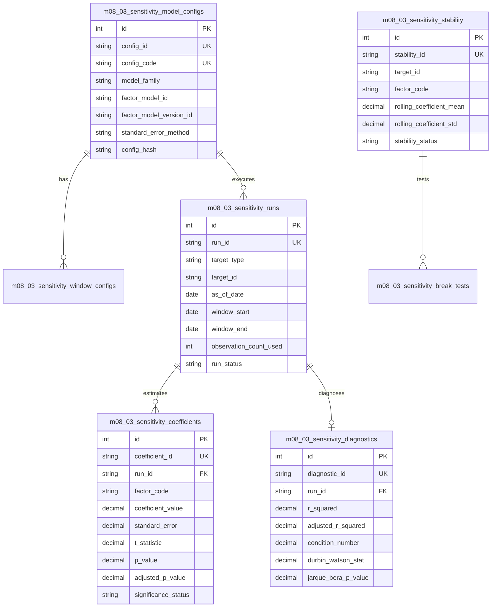

# M08.03 Factor Sensitivity Architecture

## 1. Overview and Core Purpose

**M08.03 — Factor Sensitivity** serves as the authoritative, institutional-grade econometric and statistical regression estimation engine within the Institutional Portfolio Risk Dashboard.

While **M08.01 (Factor Definition)** versions the taxonomy and recipes, and **M08.02 (Factor Exposure)** aggregates holdings-weighted portfolio exposures ($\beta_p = \sum w_i \beta_i$) and decomposes changes ($\Delta(w \beta)$), **M08.03** provides:
1. **Multi-Factor Time-Series Regressions:** Solves $R_{i,t} = \alpha_i + \sum_{k=1}^K \beta_{i,k} F_{k,t} + \epsilon_{i,t}$ using numerical methods (QR-decomposition OLS, WLS, EWLS, Ridge regularization, and IRLS Median/Quantile regression).
2. **Robust Statistical Inference:** Computes HC3 heteroskedasticity-robust, HAC Newey-West autocorrelation-consistent, and classical standard errors; two-tailed Student's t-test $p$-values; 95% confidence intervals; and Benjamini-Hochberg False Discovery Rate (FDR) adjustments for multiple testing.
3. **Rigorous Econometric Diagnostics:** Evaluates $R^2$, Adj-$R^2$, residual sum of squares (RSS), total sum of squares (TSS), residual standard error (RSE), root mean squared error (RMSE), mean absolute error (MAE), design matrix rank, SVD condition numbers, and factor Variance Inflation Factors (VIF). Evaluates residual autocorrelation via Durbin-Watson and normality via Jarque-Bera.
4. **Coefficient Stability & Structural Breaks:** Monitors parameter drift, rolling coefficient volatility, sign-inversions, and executes formal structural break hypothesis tests (Chow $F$-test).
5. **Direct Portfolio Sensitivity vs. Weighted Exposure Reconciliation:** Reconciles direct time-series portfolio regressions against bottom-up holdings-weighted exposures from M08.02 to isolate turnover, cash drag, and non-linearities.

---

## 2. Mathematical Foundations

### 2.1 Multi-Factor Design Matrix & QR Decomposition
Given aligned excess returns $y \in \mathbb{R}^T$ and factor returns $X \in \mathbb{R}^{T \times K}$:
$$\tilde{X} = [\mathbf{1}_T, X] \in \mathbb{R}^{T \times P}, \quad P = K + 1$$
Using thin QR decomposition $\tilde{X} = Q R$ where $Q^T Q = I_P$ and $R \in \mathbb{R}^{P \times P}$ is upper triangular:
$$R \hat{\beta} = Q^T y \implies \hat{\beta} = R^{-1} Q^T y$$

### 2.2 Standard Errors & Robust Covariance
- **Classical OLS:**
  $$\hat{\Sigma}_\beta = \hat{\sigma}^2 (\tilde{X}^T \tilde{X})^{-1}, \quad \hat{\sigma}^2 = \frac{1}{T - P} \sum \hat{\epsilon}_t^2$$
- **HC3 Heteroskedasticity-Consistent:**
  $$\hat{\Sigma}_{\text{HC3}} = (\tilde{X}^T \tilde{X})^{-1} \left( \sum_{t=1}^T \frac{\hat{\epsilon}_t^2}{(1 - h_{tt})^2} x_t x_t^T \right) (\tilde{X}^T \tilde{X})^{-1}$$
  where $h_{tt} = \text{diag}(Q Q^T)$ are leverage values.
- **HAC Newey-West:**
  $$\hat{\Sigma}_{\text{HAC}} = (\tilde{X}^T \tilde{X})^{-1} \left( \hat{\Gamma}_0 + \sum_{l=1}^L w_l (\hat{\Gamma}_l + \hat{\Gamma}_l^T) \right) (\tilde{X}^T \tilde{X})^{-1}, \quad w_l = 1 - \frac{l}{L+1}$$

### 2.3 Multiple Testing: Benjamini-Hochberg FDR
Sort raw $p$-values $p_{(1)} \le p_{(2)} \le \dots \le p_{(K)}$. Adjusted $p$-values are computed recursively:
$$p_{(k)}^{\text{adj}} = \min \left( 1, \min_{j \ge k} \left\{ \frac{K}{j} p_{(j)} \right\} \right)$$

### 2.4 Structural Break Chow F-Test
To test whether parameters shifted at candidate breakpoint $T_1$:
$$F = \frac{(RSS_p - (RSS_1 + RSS_2)) / P}{(RSS_1 + RSS_2) / (T - 2P)} \sim F(P, T - 2P)$$

---

## 3. Database Schema

