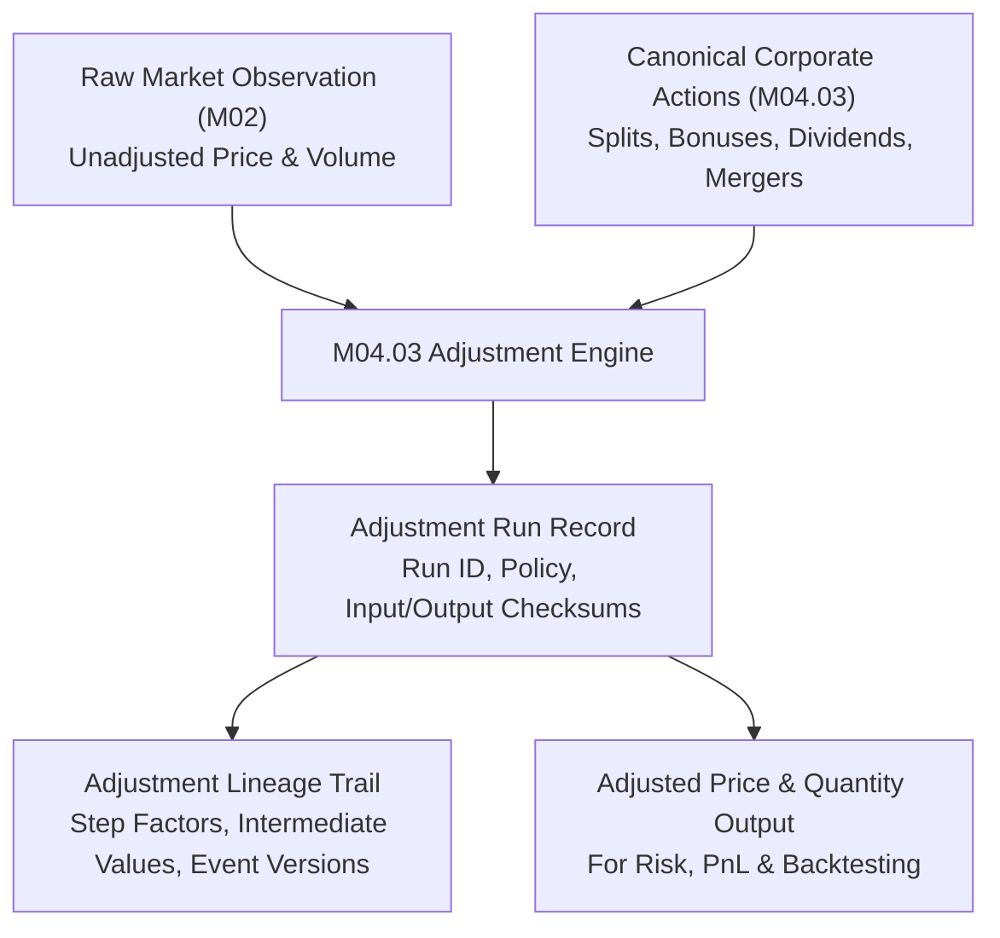

# Corporate Actions Adjustment Lineage Guide

## 1. Lineage Architecture

Institutional quantitative platforms require exact reproducibility between original market data observations and downstream adjusted series. Overwriting raw historical data causes irreproducible backtests, distorted market microstructure analytics, and regulatory non-compliance.

The **M04.03 Adjustment Lineage Framework** guarantees complete traceability through:

---

## 2. Step-by-Step Lineage Record Structure

Each execution step recorded in `corporate_action_adjustment_lineage` stores:
- **`run_id`**: Foreign key to the parent run.
- **`event_id`**: The corporate action triggering the step.
- **`event_version`**: The exact version number of the event terms applied.
- **`observation_date`**: The effective date of the corporate action.
- **`unadjusted_price`**: Original price observation.
- **`step_price_factor`**: Multiplicative factor applied at this step ($F_P$).
- **`adjusted_price`**: Running adjusted price after applying this step.
- **`unadjusted_quantity`**: Original quantity observation.
- **`step_quantity_factor`**: Multiplicative factor applied at this step ($F_Q$).
- **`adjusted_quantity`**: Running adjusted quantity after applying this step.
- **`formula_description`**: Human and machine-readable explanation of the adjustment calculation.

---

## 3. Cryptographic Verification & Auditability

To detect data tampering and ensure reproducible quantitative pipelines, each run computes two SHA-256 hashes:
1. **`input_checksum`**:
   $$\text{SHA256}(\text{instrument\_id} : \text{unadjusted\_price} : \text{unadjusted\_quantity} : \text{as\_of\_date} : \text{policy\_version})$$
2. **`output_checksum`**:
   $$\text{SHA256}(\text{adjusted\_price} : \text{adjusted\_quantity} : \text{cum\_price\_factor} : \text{cum\_quantity\_factor} : \text{total\_events})$$

This cryptographic linkage guarantees that whenever downstream models consume adjusted time series, the calculation can be reconstructed bit-for-bit from the source repository.

