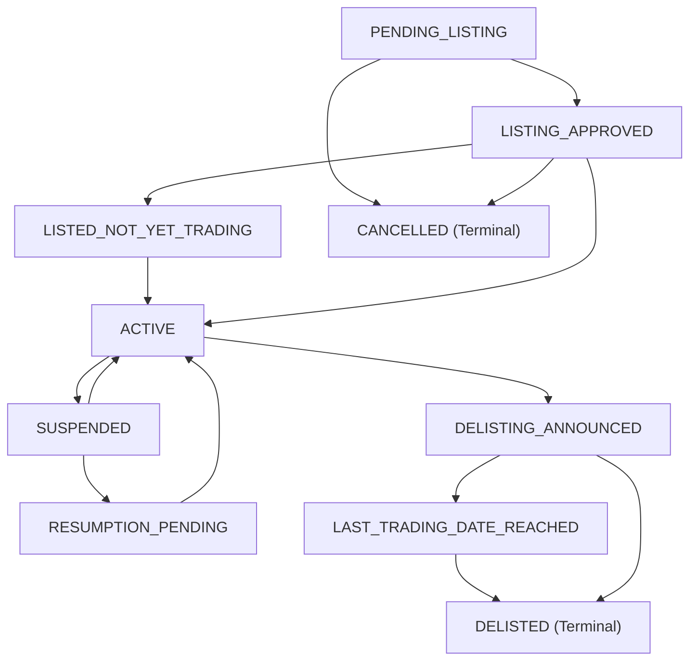

# M04.06 Instrument Lifecycle Architecture

## 1. Overview
The **M04.06 Instrument Lifecycle** submodule provides an institutional-grade, event-driven, bitemporal lifecycle management system for canonical instruments and venue-specific listings within the *Institutional Portfolio Risk Dashboard*.

### Key Design Tenets
1. **Separation of Instrument vs. Listing Lifecycle:**
   - **Canonical Instrument:** Overall corporate existence (`ACTIVE`, `PARTIALLY_TRADABLE`, `SUSPENDED_ALL_LISTINGS`, `RETIRED`).
   - **Exchange Listing:** Venue-specific tradability (`ACTIVE`, `SUSPENDED`, `RESUMPTION_PENDING`, `DELISTING_ANNOUNCED`, `DELISTED`).
   Terminating or suspending one exchange listing does not retire the security globally if other listings remain active.
2. **Governed State Machine:** Status transitions follow strict state machine validation rules. Terminal states (`DELISTED`, `CANCELLED`) cannot silently transition back to active without explicit regulatory reinstatement.
3. **Bitemporal Point-in-Time Traceability:** Distinguishes **Effective Date** (when the corporate/exchange event applies in the market) from **Recorded Timestamp** (when the platform learned of it).
4. **Scheduled Calendar vs. Instrument Tradability:** Distinguishes scheduled exchange operating hours (M04.04) from instrument-specific halts or suspensions (M04.06).

---

## 2. Listing State Machine Diagram

---

## 3. Multi-Venue Independence Example

Consider an equity listed on both the National Stock Exchange (NSE) and BSE Limited (BSE):

| Venue | Event Occurred | Listing Status | Canonical Instrument Status |
|---|---|---|---|
| Initial | Both venues active | NSE: `ACTIVE` BSE: `ACTIVE` | `ACTIVE` |
| Step 1 | BSE trading suspended | NSE: `ACTIVE` BSE: `SUSPENDED` | `PARTIALLY_TRADABLE` |
| Step 2 | BSE voluntary delisting | NSE: `ACTIVE` BSE: `DELISTED` | `PARTIALLY_TRADABLE` |
| Step 3 | NSE delisting | NSE: `DELISTED` BSE: `DELISTED` | `RETIRED` |

---

## 4. Database Schema
- `listing_lifecycle_records`: Authoritative listing record, trading dates, and fast-lookup projection.
- `listing_lifecycle_events`: Immutable bitemporal audit trail of all lifecycle events.
- `suspension_events`: Structured parameters for regulatory/voluntary halts.
- `resumption_events`: Resumption terms and link back to parent suspensions.
- `delisting_events`: Last trading date, announcement date, and effective removal dates.
