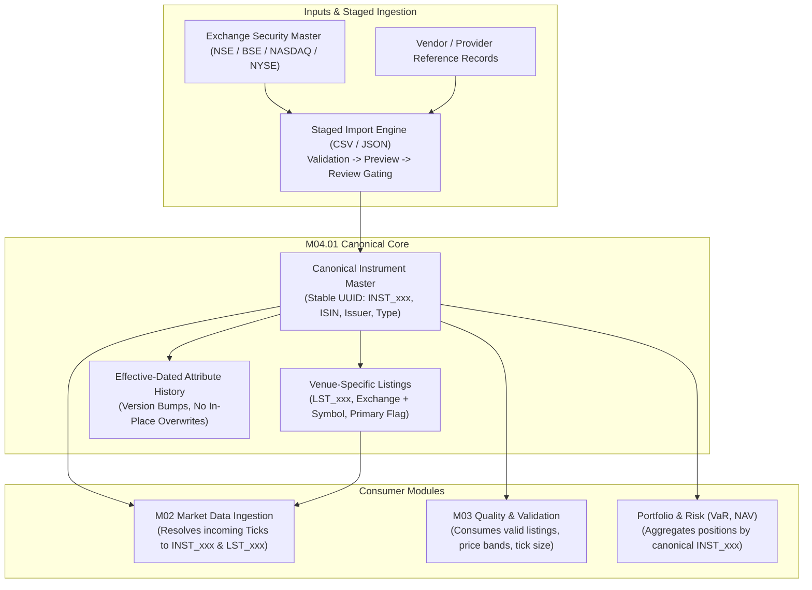

# M04.01 Instrument Master Architecture

## 1. Overview
The **M04.01 — Instrument Master Engine** establishes the canonical security identity foundation for the Institutional Portfolio Risk Dashboard.

It strictly enforces the foundational reference data principle:
> **An external symbol identifies an instrument within a particular source or venue context. It is not the platform's canonical identity.**

## 2. Canonical Identity vs. Listing Distinction
- **Canonical Instrument (`m04_instruments`):** Represents the unique underlying legal security issued by a corporate entity. Identified by a persistent internal UUID (`INST_xxx`). Stores global attributes (ISIN, Issuer, Country of Issue, Asset Class, Currency).
- **Exchange Listing (`m04_instrument_listings`):** Represents the venue-specific trading line on an exchange (e.g. Reliance on NSE is `RELIANCE`, while on BSE it is `500325`). Identified by a stable `LST_xxx` identifier linked to `INST_xxx`.
- **Primary Listing Rule:** An instrument may have multiple venue listings across India (NSE, BSE) and the US (NYSE, NASDAQ), but at most one active primary listing.

## 3. Ambiguity & Resolution Safety
- Ticker strings (`AAPL`, `RELIANCE`) are never globally unique across venues.
- Resolution requires either verified ISIN or explicit Venue Context (`exchange + symbol`).
- If an ambiguous symbol query is received across multiple venues without exchange context, M04.01 returns `AMBIGUOUS_MATCH` alongside all candidate listings rather than guessing.
