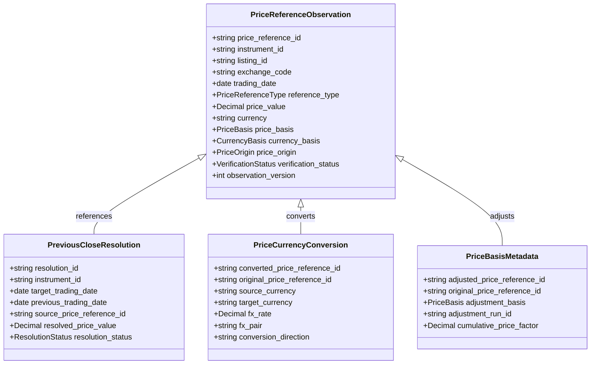

# M04.05 Price Reference Architecture

## 1. Overview
The **M04.05 Price Reference** module provides an institutional-grade, authoritative reference-price management engine for the *Institutional Portfolio Risk Dashboard*.

### Core Principles
1. **Preserve Original Observations:** Venue-published raw closing prices, auction prints, and vendor observations are never overwritten by transformed values.
2. **Independent Price and Currency Bases:**
   - **Price Basis:** `RAW`, `SPLIT_ADJUSTED`, `DIVIDEND_ADJUSTED`, `CORPORATE_ACTION_ADJUSTED`, `TOTAL_RETURN_ADJUSTED`.
   - **Currency Basis:** `NATIVE_CURRENCY`, `CONVERTED_CURRENCY`.
   A price can be currency-converted while remaining raw, or adjusted while remaining in native currency.
3. **Session-Aware Previous Close:** Previous close is resolved using the **M04.04 Trading Calendar** to identify the previous eligible exchange trading day for the listing, rather than naive calendar-day subtraction.
4. **Lineage Preservation:**
   - Currency conversions record source/target currencies, FX rates, pair conventions, and calculation timestamps.
   - Event adjustments link to M04.03 corporate action runs and event versions.

---

## 2. Reference Price Data Model

---

## 3. Supported Reference Price Types
- `OFFICIAL_CLOSE`: Official venue-published closing prices.
- `PREVIOUS_OFFICIAL_CLOSE`: The official close from the previous eligible exchange session.
- `OPENING_AUCTION_PRICE`: Final opening-auction reference price.
- `CLOSING_AUCTION_PRICE`: Final closing-auction reference price.
- `AUCTION_REFERENCE_PRICE`: Other auction reference or indicative prices.
- `SETTLEMENT_PRICE`: Regulatory or exchange-specified settlement reference.
- `THEORETICAL_REFERENCE_PRICE`: Synthetic or mathematically derived reference values.

