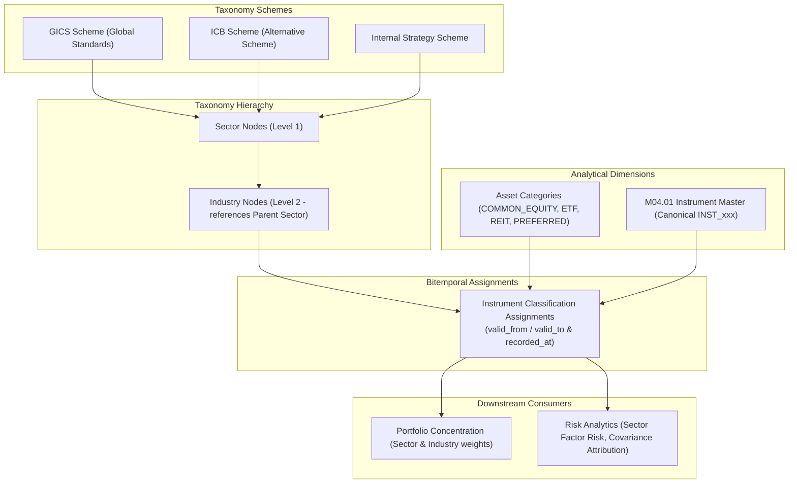

# M04.02 Security Classification Architecture

## 1. Overview
The **M04.02 — Security Classification Engine** establishes an institutional-grade, multi-scheme, bitemporal reference data architecture for the Institutional Portfolio Risk Dashboard.

It strictly adheres to the core financial axiom:
> **Classification is a time-dependent reference-data relationship, not a permanent property that can be overwritten on the instrument record.**

## 2. Multi-Scheme & Bitemporal Design
1. **Multi-Scheme Coexistence:** An instrument can concurrently hold classifications under multiple distinct schemes (e.g. GICS Technology and Internal Digital Services) without conflict.
2. **Hierarchy Validation:** Every `INDUSTRY` node strictly enforces a valid `parent_node_id` pointing to an active `SECTOR` within the same scheme and version.
3. **Asset Category Compatibility:** Enforces consistency with M04.01 canonical `instrument_type` (e.g. an ETF is prohibited from being categorized as `COMMON_EQUITY`).
4. **Bitemporal Point-In-Time Queries:**
   - **Valid Time:** The real-world date range (`valid_from` to `valid_to`) when the classification applies.
   - **Transaction Time:** The exact timestamp (`recorded_at`) when the platform learned of the assignment.
   - Look-ahead bias is eliminated during historical backtesting by querying both axes.
