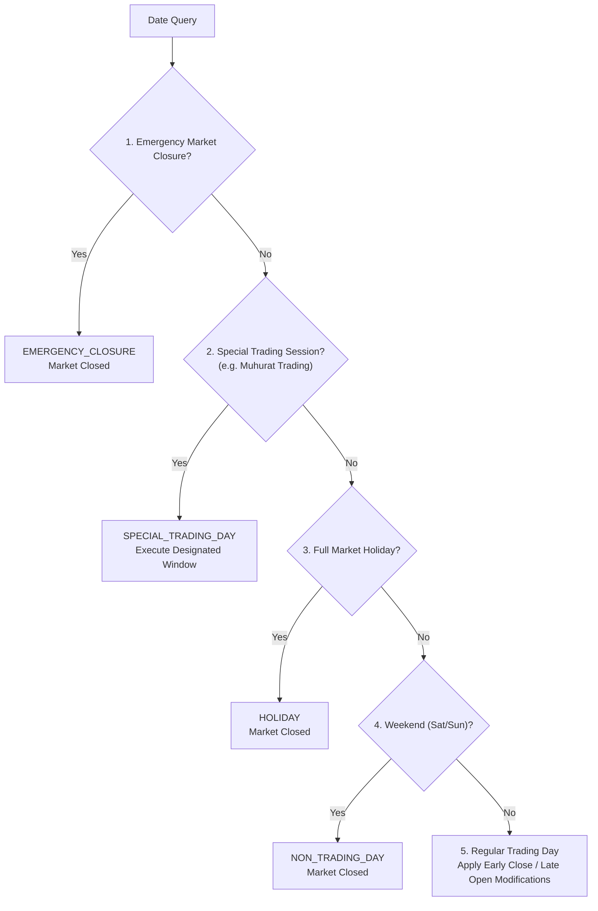

# M04.04 Trading Calendar Architecture

## 1. Overview
The **M04.04 Trading Calendar** module provides an institutional-grade, exchange-aware operating schedule, session resolution, and calendar exception management engine for equity markets across India (NSE, BSE) and the United States (NYSE, NASDAQ).

### Core Principles
1. **Exchange-Specific Calendars:** Every exchange and segment possesses its own independently configured calendar, sessions, holidays, and exceptions.
2. **Local-Time Authority & IANA Timezones:** Session rules are strictly defined using exchange-local wall-clock times and IANA timezone identifiers (`Asia/Kolkata`, `America/New_York`). Conversions to UTC are dynamically computed using Python `zoneinfo` across daylight saving time (DST) shifts.
3. **Strict Exception Precedence:** Date-specific overrides and closures take deterministic precedence over default weekly schedules.
4. **Scheduled State vs. Live State:** The trading calendar defines scheduled operating hours only; it does not determine live exchange connectivity, halt states, or execution authorization.

---

## 2. Schedule Exception Precedence Hierarchy

When evaluating the market schedule for a specific date, the resolution engine evaluates rules in strict order:

---

## 3. Timezone & Daylight Saving Time (DST) Handling

- **India (`Asia/Kolkata`):** Operates on static UTC+05:30 year-round with no DST transitions.
- **US Eastern (`America/New_York`):** Dynamically alternates between Standard Time (EST, UTC-05:00) and Daylight Time (EDT, UTC-04:00).
- Local session times (e.g. 09:30 - 16:00) yield different UTC intervals across winter and summer dates without modifying the underlying session template.

---

## 4. Supported Market Sessions

- `PRE_OPEN`: Pre-market order entry and order modification windows.
- `REGULAR_TRADING`: Continuous execution and trade matching.
- `CLOSING_AUCTION`: End-of-day volume matching and closing price discovery.
- `POST_MARKET`: Post-close reporting and trade adjustments.
- `SPECIAL_SESSION`: Exchange-sanctioned one-off trading windows (e.g. Diwali Muhurat trading).
- `CLOSED`: Market is non-operational.

