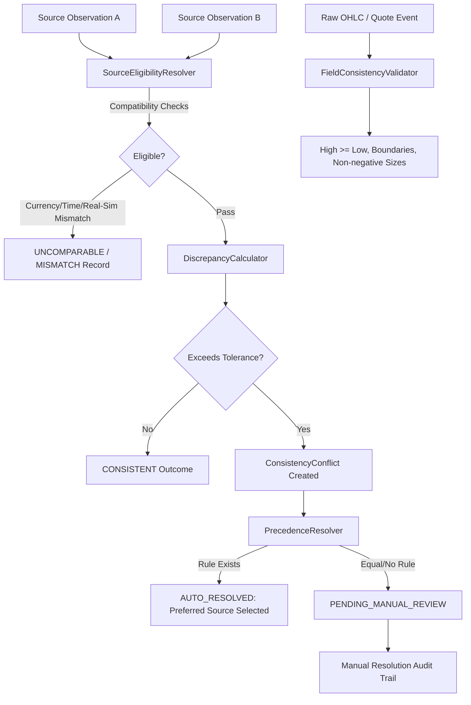

# M03.06 — Data Consistency Architecture

## 1. Overview & Objective
`M03.06 — Data Consistency` establishes an institutional-grade cross-feed comparison, price discrepancy detection, field relationship validation, and source-precedence conflict management engine. It guarantees that multi-source equity market data across NSE, BSE, NASDAQ, and NYSE is mutually consistent, internally coherent, and auditable before entering downstream portfolio risk and execution models.

---

## 2. Core Architecture & Subfeatures

### 2.1 M03.06.01 — Cross-Feed Comparison
- Evaluates instrument matching, currency equivalence, and timestamp alignment (within configurable milliseconds).
- **Real vs. Simulated Isolation:** Strictly forbids comparing real Alpha Vantage observations against synthetic simulator records as independent confirmations.

### 2.2 M03.06.02 — Price Discrepancy Detection
- Calculates exact Decimal-based absolute differences ($|P_A - P_B|$) and reference or symmetric percentage divergence ($\frac{|P_A - P_B|}{P_{\text{ref}}} \times 100$).
- Enforces configurable percentage (e.g. 0.50%) and absolute tolerances with severity classification (`PASS`, `WARNING`, `CRITICAL`).

### 2.3 M03.06.03 — Field Consistency
- **OHLC Integrity:** Validates $\text{High} \ge \text{Low}$, $\text{High} \ge \text{Open}$, $\text{High} \ge \text{Close}$, $\text{Low} \le \text{Open}$, and $\text{Low} \le \text{Close}$.
- **Quote Displayed Sizes:** Asserts resting displayed bid and ask quantities are non-negative ($Q \ge 0$) and prices are positive ($P > 0$).

### 2.4 M03.06.04 — Conflict Resolution & Source Precedence
- Configurable, effective-dated source priority rankings (`SourcePrecedenceRule`).
- Automatically resolves discrepancies by selecting the preferred eligible source.
- Equal-priority or ambiguous conflicts enter `PENDING_MANUAL_REVIEW`.
- Operator resolutions are recorded with an immutable audit log (`ConsistencyResolutionHistory`).
