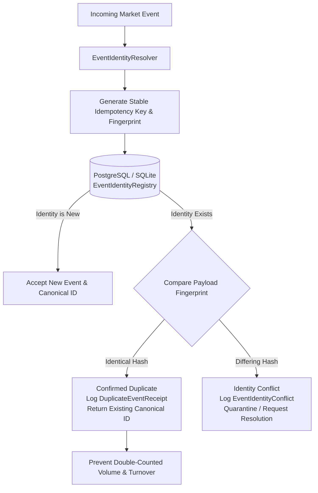

# M03.05 — Duplicate Detection & Idempotency Architecture

## 1. Overview & Business Objective
`M03.05 — Duplicate Detection` establishes an institutional-grade event identity resolution and database-level idempotency framework. It guarantees that replayed, retried, or duplicated market data messages (trades, quotes, order book snapshots, deltas, and historical OHLCV bars) are intercepted before creating second business records or inflating financial calculations (volume, turnover, trade count, queue depths).

---

## 2. Event Identity Hierarchy
Rather than simplistic price/quantity matching (which falsely drops separate legitimate executions in active markets), `M03.05` enforces a strict identity hierarchy:

1. **Exchange Trade ID (`EXCHANGE_TRADE_ID`):** Highest precedence for trade events. Scoped by `EXCHANGE:INSTRUMENT:TRADE_DATE:EXCHANGE_TRADE_ID`.
2. **Provider Event ID (`PROVIDER_EVENT_ID`):** Scoped by `PROVIDER:FEED:INSTRUMENT:EVENT_TYPE:PROVIDER_EVENT_ID`.
3. **Sequence Identity (`SEQUENCE_ID`):** Scoped by `PROVIDER:FEED:INSTRUMENT:EVENT_TYPE:CONNECTION_EPOCH:SEQUENCE_NUMBER`.
4. **Natural Bar Key (`OHLCV_NATURAL_KEY`):** For historical bars, scoped by `PROVIDER:FEED:INSTRUMENT:INTERVAL:START_TIMESTAMP`.
5. **Composite Payload Fingerprint (`COMPOSITE_FINGERPRINT`):** Deterministic SHA-256 hash of immutable business fields. Excludes volatile local arrival or insertion timestamps.

---

## 3. Atomic Database Idempotency Flow

