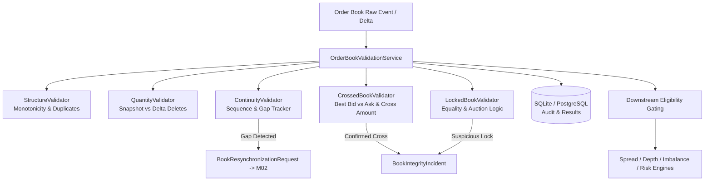

# M03.04 — Order Book Validation Engine Architecture

## 1. Overview & Objective
`M03.04 — Order Book Validation` evaluates the internal consistency, validity, structural arrangement, and sequence continuity of displayed order book depth (Level 1 / Level 2 snapshots and incremental deltas) before downstream risk, portfolio, and microstructure analytics consume them.

The engine prevents corrupted, crossed, locked, or desynchronized order books from contaminating:
- Bid-Ask Spread Analytics
- Order Book Imbalance (OBI)
- Market Depth & Cumulative Liquidity
- Value at Risk (VaR) & Expected Shortfall (ES)
- Market Impact & Optimal Execution Analytics

---

## 2. Core Validation Subfeatures

### 2.1 M03.04.01 — Crossed Book Detection
- **Condition:** $\text{Best Bid} > \text{Best Ask}$.
- **Cross Amount:** $\Delta_{\text{cross}} = \text{Best Bid} - \text{Best Ask}$.
- **Auction Phase Awareness:** Crossed books during pre-open and closing call auctions reflect normal order accumulation prior to clearing and are classified as `AUCTION_CROSS_VALID` (`is_valid = True`, `spread_eligible = False`, `imbalance_eligible = True`).
- **Continuous Session Crossing:** Classified as `CROSSED_TRANSIENT` ($\le 50\text{ms}$) or `CROSSED_CONFIRMED` ($> 50\text{ms}$, `is_valid = False`, `severity = ERROR`).

### 2.2 M03.04.02 — Locked Book Detection
- **Condition:** $\text{Best Bid} == \text{Best Ask}$.
- **Session & Venue Handling:** 
  - Auction sessions: Classified as `LOCKED_AUCTION_VALID`.
  - Continuous sessions: Transient locks ($\le 100\text{ms}$) classified as `LOCKED_TRANSIENT`. Persistent locks classified as `LOCKED_SUSPICIOUS` (`is_valid = False`).
- **Metric Gating:** Spread calculation is gated (`spread_eligible = False`) because spread equals zero, which would cause division-by-zero or distorted percentage-spread metrics. Imbalance and depth metrics remain eligible (`imbalance_eligible = True`).

### 2.3 M03.04.03 — Displayed Quantity Validation
- Rejects non-numeric, `NaN`, infinite, or negative quantities.
- **Snapshot Strictness:** Full snapshots must NEVER contain zero or negative quantities. Any level with $Q \le 0$ causes immediate rejection.
- **Incremental Delta Deletion:** Delta updates with $Q = 0$ are permitted **only** when the operation is `DELETE` (or `REMOVE`). Any `UPDATE` or `INSERT` with $Q = 0$ is rejected.
- Validates fractional share rules and minimum lot sizes by venue (e.g. Indian equities reject fractional shares).

### 2.4 M03.04.04 — Continuity & M02 Resynchronization
- Asserts strict sequence number monotonicity between snapshots and incremental deltas.
- Detects backwards sequences (`SEQUENCE_BACKWARDS`) and gaps (`SEQUENCE_GAP`).
- Automatically triggers resynchronization requests (`BookResynchronizationRequest`) to M02 and gates all downstream metrics (`spread_eligible = False`, `liquidity_eligible = False`) until an uncrossed, contiguous snapshot restores integrity.

### 2.5 Structure & Monotonicity
- **Bids:** Strictly descending by price ($\text{Bid}_1 > \text{Bid}_2 > \dots > \text{Bid}_n$).
- **Asks:** Strictly ascending by price ($\text{Ask}_1 < \text{Ask}_2 < \dots < \text{Ask}_n$).
- **Uniqueness:** Flags and rejects duplicate price levels on the same side.

---

## 3. Data Model & Architecture Diagram

