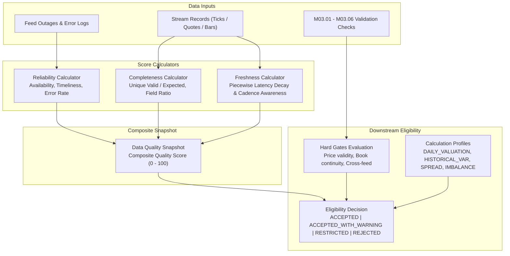

# M03.07 Quality Scoring Architecture

## 1. Overview
The **M03.07 Quality Scoring & Use Eligibility Engine** evaluates market data fitness quantitatively and deterministically across four dimensions:
1. **Feed Reliability:** Measures infrastructure and transport uptime, timeliness, and operational error rates over rolling windows (1h, 6h, 24h, 7d, 30d).
2. **Completeness:** Measures observed valid unique records against expected benchmarks, alongside field-level presence.
3. **Freshness:** Evaluates observation latency using a piecewise continuous scoring function with calendar and market cadence awareness.
4. **Use Eligibility:** Governs downstream financial module consumption with hard-gate safety checks overriding score thresholds.

## 2. Hard Gate Safety Architecture
A dataset may have a high availability or completeness score, but if a single structural corruption exists (such as a negative price or broken order-book delta sequence), downstream risk engines could fail catastrophically. The eligibility evaluator enforces hard gate prerequisites before granting permissions:
- **Price Validity Gate:** Ensures price is not null, non-negative, and passes M03.02 price checks.
- **Timestamp Integrity Gate:** Ensures no future timestamps, clock drift anomalies, or retrograde timestamps.
- **Order Book Continuity Gate:** Ensures bid/ask spread is non-crossed and sequence deltas have no gaps.
- **Cross-Feed Consistency Gate:** Ensures no irreconcilable deviation between primary and secondary feeds.
- **Provider Capability Gate:** Checks whether the feed legitimately supports the requested data type.
