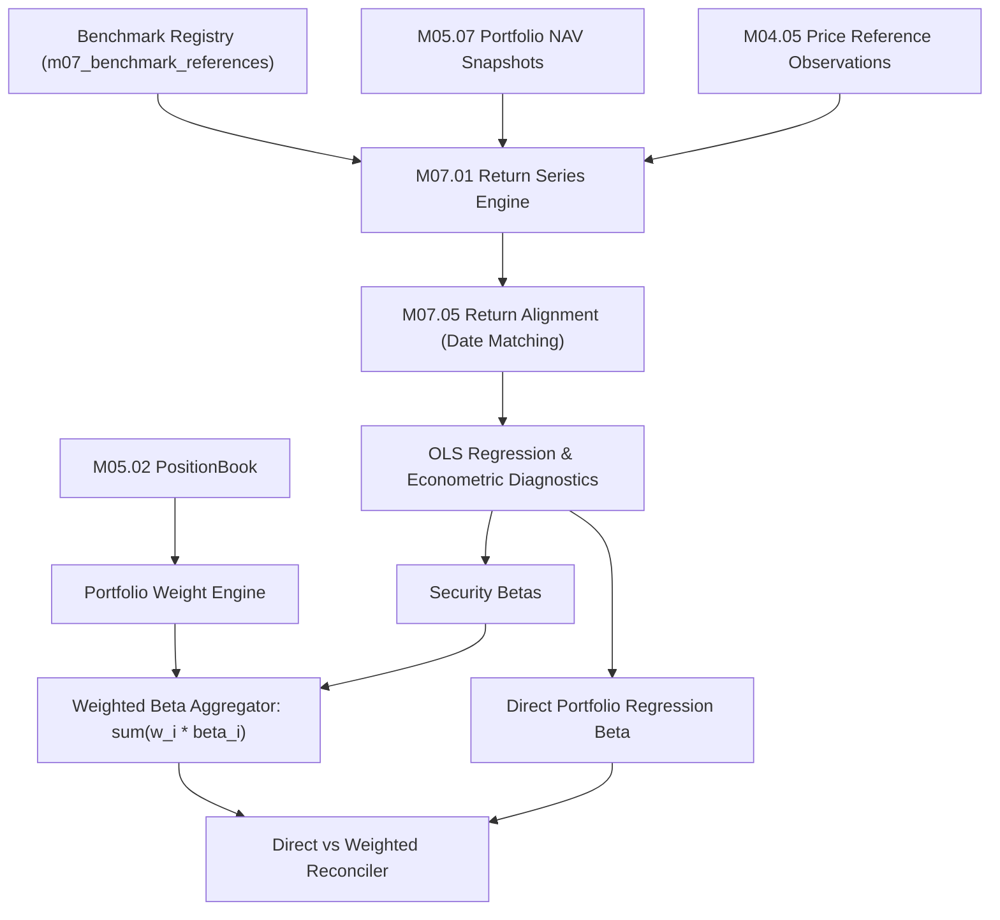

# M07.07 Portfolio Beta Architecture

## 1. Overview
The **M07.07 Portfolio Beta Engine** provides institutional-grade sensitivity analytics of individual securities and overall portfolio investment structures to explicitly selected reference benchmarks using statistically rigorous Ordinary Least Squares (OLS) regressions.

The module supports:
1. **Single Security Beta:** Regressing single instrument returns against benchmark returns with full econometric diagnostics ($R^2$, adjusted $R^2$, standard errors, Student's $t$-statistic, $p$-values, and 95% confidence intervals).
2. **Portfolio Beta (Two Methodologies):**
   - **Direct Portfolio Regression:** Regresses historical portfolio NAV returns directly on the benchmark returns ($R_{p,t} = \alpha_p + \beta_p R_{b,t} + \epsilon_{p,t}$).
   - **Current-Weight Implied Beta:** Calculates the portfolio beta as the weighted linear combination of individual security betas ($\beta_p = \sum_{i=1}^N w_i \beta_i$) alongside each holding's component risk contribution ($w_i \beta_i$) and percentage contribution.
3. **Direct vs Weighted Reconciliation:** Quantifies discrepancy between direct historical regression and current-weight implied beta, documenting effects of past rebalancing, cash drag, and weight evolution.
4. **Benchmark Registry & Governance:** Governs active benchmarks (e.g. `NIFTY_50`, `NIFTY_BANK`, `SPX`, `NDX`) tracking provider, market, base currency, and return basis (Total Return vs Price Return).

## 2. Mathematical & Econometric Formulations

### 2.1 OLS Regression
$$R_{i,t} = \alpha_i + \beta_i R_{b,t} + \epsilon_{i,t}$$

$$\beta_i = \frac{\operatorname{Cov}(R_i, R_b)}{\operatorname{Var}(R_b)} = \frac{\sum_{t=1}^n (R_{b,t} - \bar{R}_b)(R_{i,t} - \bar{R}_i)}{\sum_{t=1}^n (R_{b,t} - \bar{R}_b)^2}$$

$$\alpha_i = \bar{R}_i - \beta_i \bar{R}_b$$

### 2.2 Goodness of Fit & Statistical Diagnostics
- **Coefficient of Determination ($R^2$):**
  $$R^2 = 1 - \frac{\sum \epsilon_{i,t}^2}{\sum (R_{i,t} - \bar{R}_i)^2}$$
- **Adjusted $R^2$:**
  $$R^2_{\text{adj}} = 1 - (1 - R^2) \frac{n - 1}{n - k - 1}$$
- **Standard Error of Beta:**
  $$SE(\hat{\beta}_i) = \frac{s_\epsilon}{\sqrt{\sum (R_{b,t} - \bar{R}_b)^2}}, \quad s_\epsilon = \sqrt{\frac{\sum \epsilon_{i,t}^2}{n - 2}}$$
- **Hypothesis Testing:**
  $$t_{\hat{\beta}} = \frac{\hat{\beta}}{SE(\hat{\beta})}, \quad p = 2 \cdot (1 - F_t(|t_{\hat{\beta}}|; n - 2))$$
- **95% Confidence Intervals:**
  $$\hat{\beta} \pm t_{0.975, n-2} \cdot SE(\hat{\beta})$$

### 2.3 Portfolio Beta Aggregation & Component Risk Contribution
$$\beta_p = \sum_{i=1}^N w_i \beta_i$$
$$\text{Beta Contribution}_i = w_i \cdot \beta_i$$
$$\text{Percentage Contribution}_i = \frac{w_i \cdot \beta_i}{\beta_p} \times 100\%$$
