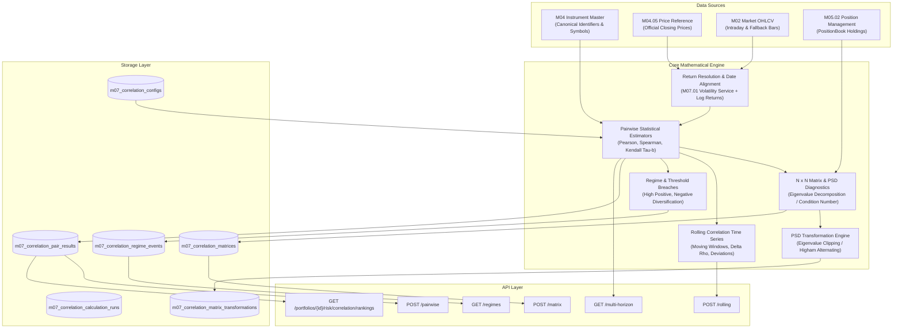

# M07.05 — Correlation Analysis Engine: Technical Architecture

## 1. Executive Summary & Purpose
The **M07.05 Correlation Analysis** module is an institutional-grade quantitative risk system designed to quantify co-movement, cross-asset dependence, diversification benefits, and structural regime shifts across portfolio holdings, custom asset universes, and market benchmarks.

Unlike toy statistical calculators, M07.05:
1. **Never calculates correlation directly from raw price levels**; it aligns daily log returns ($R_t$) across common sessions.
2. Supports **Pearson product-moment**, **Spearman rank**, and **Kendall $\tau_b$** non-parametric estimators with full significance testing ($t$-statistic, standard error, $p$-value, Fisher $z$-transformed 95% confidence intervals).
3. Constructs complete $N \times N$ correlation matrices with **Positive Semi-Definite (PSD) eigenvalue diagnostics** ($\lambda_{\min} \ge 0$, condition number, negative eigenvalue counts).
4. Provides **non-destructive PSD matrix repair** (spectral eigenvalue clipping with diagonal renormalization, or Higham's nearest correlation matrix algorithm) without mutating raw empirical matrices.
5. Monitors **rolling correlation dynamics** ($\Delta \rho_t$, baseline deviations) and automated **regime detection** (high co-movement $\rho \ge 0.70$, strong negative diversification $\rho \le -0.50$, rapid shifts, and persistence).

---

## 2. Architectural Boundaries & Data Lineage

---

## 3. Mathematical Specifications

### 3.1 Pairwise Estimators
Given aligned return vectors $X = \{r_{A, t}\}_{t=1}^n$ and $Y = \{r_{B, t}\}_{t=1}^n$:

1. **Pearson Correlation Coefficient ($\rho$):**
   $$\rho = \frac{\sum_{t=1}^n (r_{A, t} - \bar{r}_A)(r_{B, t} - \bar{r}_B)}{\sqrt{\sum_{t=1}^n (r_{A, t} - \bar{r}_A)^2 \sum_{t=1}^n (r_{B, t} - \bar{r}_B)^2}}$$

2. **Significance & Standard Error:**
   $$t = \rho \sqrt{\frac{n-2}{1-\rho^2}}, \quad \text{SE}(\rho) = \sqrt{\frac{1-\rho^2}{n-2}}$$

3. **Fisher $z$-Transformation 95% Confidence Intervals:**
   $$z = \operatorname{arctanh}(\rho), \quad \sigma_z = \frac{1}{\sqrt{n-3}}$$
   $$\text{CI}_{95\%} = \left[\tanh\left(z - 1.96 \sigma_z\right), \tanh\left(z + 1.96 \sigma_z\right)\right]$$

4. **Spearman Rank Correlation:**
   Evaluates rank monotonic co-movement via fractional ranking with average tie resolutions.

5. **Kendall Tau-b:**
   $$\tau_b = \frac{P - Q}{\sqrt{(P + Q + T_X)(P + Q + T_Y)}}$$
   where $P$ is concordant pairs, $Q$ is discordant pairs, and $T_X, T_Y$ are tie adjustments.

### 3.2 Matrix Construction & PSD Diagnostics
For an $N$-asset universe, the correlation matrix $C \in \mathbb{R}^{N \times N}$ satisfies:
- $C_{ii} = 1.0$
- $C_{ij} = C_{ji}$
- Eigenvalues $\{\lambda_k\}_{k=1}^N$ via symmetric decomposition (`scipy.linalg.eigh` or `numpy.linalg.eigvalsh`).
- If $\min_k(\lambda_k) < -10^{-8}$, the matrix is marked `NON_PSD`.

### 3.3 Positive Semi-Definite Matrix Repair
When pairwise missing data results in non-positive semidefinite matrices, two non-destructive transformations are supported:
1. **Spectral Clipping:**
   $$\hat{C} = V \operatorname{diag}\left(\max(\lambda_k, \varepsilon)\right) V^T, \quad \tilde{C}_{ij} = \frac{\hat{C}_{ij}}{\sqrt{\hat{C}_{ii} \hat{C}_{jj}}}$$
2. **Higham (2002) Alternating Projections:**
   Iteratively projects between the closed convex cone of PSD matrices and the affine subspace of unit diagonal symmetric matrices.
