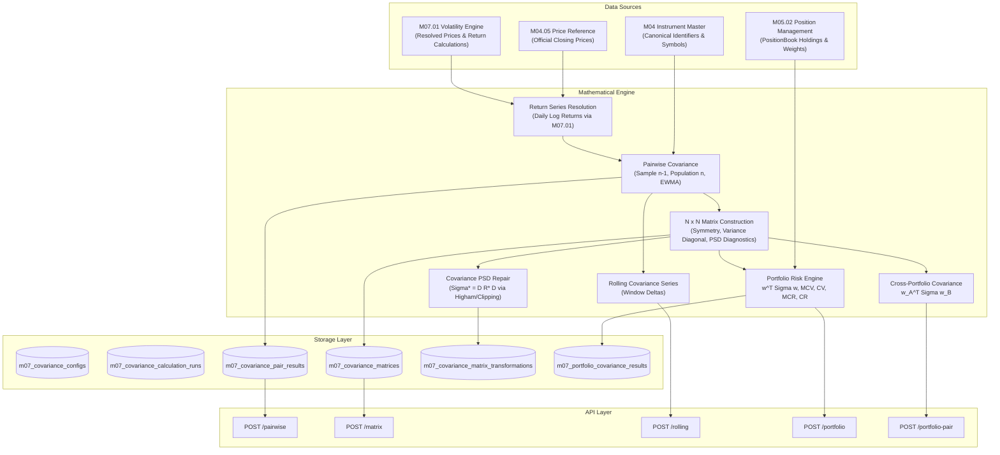

# M07.06 — Covariance Analysis Engine: Technical Architecture

## 1. Executive Summary & Purpose
The **M07.06 Covariance Analysis** module is an institutional-grade quantitative risk system that models the joint variability of asset returns and provides the foundational statistical input for portfolio risk models (e.g., portfolio variance, risk budgeting, factor models, and parametric VaR/Expected Shortfall).

### Core Capabilities:
1. **Never calculates covariance directly from price levels**; operates strictly on aligned return vectors ($R_t$).
2. **Multi-Estimator Suite:** Supports unbiased sample covariance ($n-1$ denominator), population covariance ($n$ denominator), and Exponentially Weighted Moving Average (EWMA) covariance.
3. **Portfolio Covariance & Risk Contributions:** Computes portfolio variance ($\sigma_p^2 = \mathbf{w}^T \Sigma \mathbf{w}$), portfolio volatility ($\sigma_p = \sqrt{\mathbf{w}^T \Sigma \mathbf{w}}$), Marginal Contributions to Variance ($MCV_i = (\Sigma \mathbf{w})_i$), Component Contributions to Variance ($CV_i = w_i (\Sigma \mathbf{w})_i$), Marginal Contributions to Volatility ($MCR_i = (\Sigma \mathbf{w})_i / \sigma_p$), and Component Contributions to Volatility ($CR_i = w_i (\Sigma \mathbf{w})_i / \sigma_p$).
4. **Cross-Portfolio Covariance:** Evaluates joint co-movement between two portfolios: $\operatorname{Cov}(R_A, R_B) = \mathbf{w}_A^T \Sigma \mathbf{w}_B$.
5. **Positive Semi-Definite (PSD) Diagnostics & Repair:** Eigenvalue decomposition via symmetric solver (`numpy.linalg.eigvalsh`), condition number diagnostics, symmetry checks, and non-destructive PSD matrix reconstruction ($\Sigma^* = D R^* D$).
6. **Rolling Covariance Dynamics:** Moving window covariance tracking with step-to-step changes ($\Delta \Sigma_{ij, t}$).

---

## 2. Architectural Boundaries & Data Flow

---

## 3. Mathematical Specifications

### 3.1 Pairwise Estimators
Given aligned returns $X = \{r_{A, t}\}_{t=1}^n$ and $Y = \{r_{B, t}\}_{t=1}^n$:

1. **Sample Covariance ($n-1$ denominator):**
   $$\operatorname{Cov}(X, Y) = \frac{1}{n-1} \sum_{t=1}^n (x_t - \bar{x})(y_t - \bar{y})$$

2. **Population Covariance ($n$ denominator):**
   $$\operatorname{Cov}_{\text{pop}}(X, Y) = \frac{1}{n} \sum_{t=1}^n (x_t - \bar{x})(y_t - \bar{y})$$

3. **Relationship with Correlation and Volatilities:**
   $$\operatorname{Cov}(X, Y) = \rho_{XY} \sigma_X \sigma_Y$$

4. **Units:**
   Covariance is expressed in **decimal-return squared** ($R^2$).

### 3.2 Portfolio Variance & Risk Contributions
For asset weight vector $\mathbf{w}$ and covariance matrix $\Sigma$:

1. **Portfolio Variance:**
   $$\sigma_p^2 = \mathbf{w}^T \Sigma \mathbf{w} = \sum_{i=1}^N w_i^2 \Sigma_{ii} + 2 \sum_{i < j} w_i w_j \Sigma_{ij}$$

2. **Portfolio Volatility:**
   $$\sigma_p = \sqrt{\mathbf{w}^T \Sigma \mathbf{w}}$$

3. **Marginal Contribution to Variance ($MCV$):**
   $$MCV_i = (\Sigma \mathbf{w})_i$$

4. **Component Contribution to Variance ($CV$):**
   $$CV_i = w_i (\Sigma \mathbf{w})_i, \quad \sum_{i=1}^N CV_i = \sigma_p^2$$

5. **Marginal Contribution to Volatility ($MCR$):**
   $$MCR_i = \frac{(\Sigma \mathbf{w})_i}{\sigma_p}$$

6. **Component Contribution to Volatility ($CR$):**
   $$CR_i = w_i \frac{(\Sigma \mathbf{w})_i}{\sigma_p}, \quad \sum_{i=1}^N CR_i = \sigma_p$$

### 3.3 Positive Semi-Definite Matrix Regularization
When empirical covariance matrices fail PSD constraints ($\lambda_{\min} < -10^{-8}$):
1. Extract standard deviations $D = \operatorname{diag}(\sqrt{\Sigma_{ii}})$.
2. Compute correlation matrix $R = D^{-1} \Sigma D^{-1}$.
3. Regularize correlation matrix $R^*$ to the nearest PSD correlation matrix using spectral eigenvalue clipping or Higham alternating projections.
4. Reconstruct covariance matrix:
   $$\Sigma^* = D R^* D$$
Original empirical matrices are never mutated in-place; all transformed matrices are recorded in `m07_covariance_matrix_transformations`.
