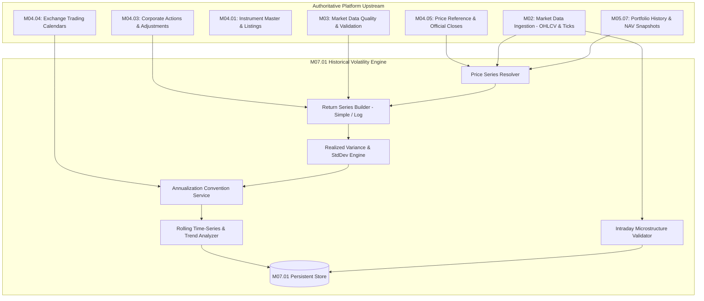

# M07.01 — Historical Volatility: Architecture Specification

## 1. Executive Summary

Module **M07.01 Historical Volatility** serves as the authoritative quantitative realized volatility engine within the **Institutional Portfolio Risk Dashboard**. It estimates the variability of asset and portfolio returns over configurable lookback windows using sample standard deviation of observed returns, versioned annualization conventions, and multi-horizon comparative analytics.

### Key Tenets
1. **Separation of Realized vs. Modelled Volatility:** Strictly estimates observed historical realized volatility. Implied volatility, EWMA, and GARCH forecasts are prohibited within M07.01.
2. **Statistical Rigor & Numerical Stability:** Implements two-pass sample variance (\(N - 1\) degrees of freedom) and pure deterministic `Decimal` / `NUMERIC(18, 8)` representation.
3. **Explicit Annualization Scaling:** Every annualized result is parameterized by an authoritative annual trading-session or intraday period convention (\(\sigma_{annual} = \sigma_{period} \times \sqrt{N_{periods}}\)).
4. **Data Quality & Microstructure Suitability:** Detects missing observations, data gaps, crossed quotes, and sparse intraday trading without silently forward-filling or fabricating returns.
5. **Multi-Horizon & Trend Diagnostics:** Enables comparative analysis across short (20d), medium (60d), and long (252d) horizons and computes ordinary least squares (OLS) trend slopes.

---

## 2. Integration Architecture

M07.01 integrates seamlessly across the platform without duplicating market data ingestion, reference databases, or portfolio ledgers:

---

## 3. Mathematical Specifications

### 3.1 Return Series Formulations
- **Logarithmic Returns (Default):**
  $$r_t = \ln\left(\frac{P_t}{P_{t-1}}\right)$$
- **Simple Returns:**
  $$r_t = \frac{P_t}{P_{t-1}} - 1$$

### 3.2 Two-Pass Sample Standard Deviation
$$\bar{r} = \frac{1}{n}\sum_{t=1}^{n} r_t$$
$$s = \sqrt{\frac{1}{n-1}\sum_{t=1}^{n}(r_t - \bar{r})^2}$$

### 3.3 Annualization Convention
$$\sigma_{annual} = s \times \sqrt{N_{periods,annual}}$$
- **Daily Equity Sessions:** \(N_{periods} = 252 \implies \sqrt{252} \approx 15.874508\)
- **Intraday 5m Bars (US Equity 6.5h session):** \(N_{periods} = 252 \times 78 = 19,656 \implies \sqrt{19656} \approx 140.200000\)

### 3.4 Multi-Horizon Spread & Ratios
$$Spread_{S,L} = \sigma_S - \sigma_L$$
$$Ratio_{S,L} = \frac{\sigma_S}{\sigma_L} \quad (\sigma_L > 0)$$

### 3.5 Ordinary Least Squares (OLS) Trend Slope
$$\sigma_t = \alpha + \beta t$$
$$\beta = \frac{\sum (t - \bar{t})(\sigma_t - \bar{\sigma})}{\sum (t - \bar{t})^2}$$
