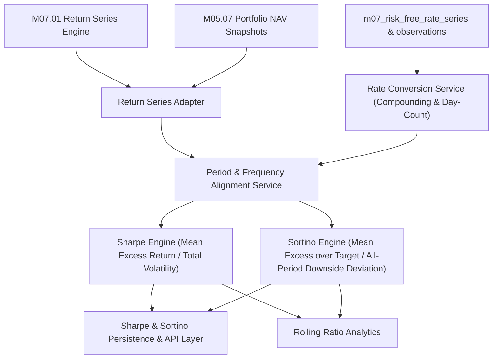

# M07.08 Sharpe & Sortino Ratios Architecture

## 1. Overview
The **M07.08 Sharpe & Sortino Ratios Engine** provides institutional-grade risk-adjusted performance measurement for individual securities, portfolios, and portfolio groups. It measures excess return relative to total return variability (Sharpe) and downside variability relative to a target return (Sortino).

---

## 2. Mathematical Formulations

### 2.1 Sharpe Ratio
$$X_t = R_{p,t} - R_{f,t}$$
$$\bar{X} = \frac{1}{n} \sum_{t=1}^n X_t$$

Denominator policies:
- **`PORTFOLIO_RETURN_VOLATILITY` (Default):**
  $$s_R = \sqrt{\frac{1}{n-1} \sum_{t=1}^n (R_{p,t} - \bar{R}_p)^2}$$
- **`EXCESS_RETURN_VOLATILITY`:**
  $$s_X = \sqrt{\frac{1}{n-1} \sum_{t=1}^n (X_t - \bar{X})^2}$$

Period and Annualized Sharpe:
$$\text{Sharpe}_{\text{period}} = \frac{\bar{X}}{s_R}, \quad \text{Sharpe}_{\text{annual}} = \text{Sharpe}_{\text{period}} \cdot \sqrt{A}$$
where $A = 252$ for daily equity observations.

---

### 2.2 Sortino Ratio & All-Period Downside Deviation
Let $T_t$ be the target return (Risk-Free Rate or constant Minimum Acceptable Return, MAR).

Target shortfall:
$$d_t = \min(0, R_{p,t} - T_t)$$

**Standard Sortino Downside Deviation (`ALL_PERIODS_SEMIDEVIATION`):**
The denominator uses the entire sample size $n$, reflecting downside volatility scaled over the entire evaluation horizon:
$$DD_T = \sqrt{\frac{1}{n} \sum_{t=1}^n \left[\min(0, R_{p,t} - T_t)\right]^2}$$

Mean return above target:
$$\overline{R_p - T} = \frac{1}{n} \sum_{t=1}^n (R_{p,t} - T_t)$$

Period and Annualized Sortino:
$$\text{Sortino}_{\text{period}} = \frac{\overline{R_p - T}}{DD_T}, \quad \text{Sortino}_{\text{annual}} = \text{Sortino}_{\text{period}} \cdot \sqrt{A}$$

Zero Downside Handling:
If $DD_T < 10^{-12}$, the ratio is reported as `ZERO_DOWNSIDE_DEVIATION` with null ratio rather than returning a fabricated infinite scalar.

---

### 2.3 Risk-Free Rate Compounding & Conversion
- **Effective Annual Rate (`EFFECTIVE_ANNUAL_RATE`):**
  $$R_{f,t} = (1 + y_t)^\tau - 1, \quad \tau = \frac{\text{days}}{\text{divisor}}$$
- **Simple Annual Rate (`SIMPLE_ANNUAL_RATE`):**
  $$R_{f,t} = y_t \cdot \tau$$
- **Continuously Compounded (`CONTINUOUSLY_COMPOUNDED`):**
  $$R_{f,t} = e^{c_t \cdot \tau} - 1$$
Divisor is $365$ (`ACTUAL_365`) or $360$ (`ACTUAL_360`).
