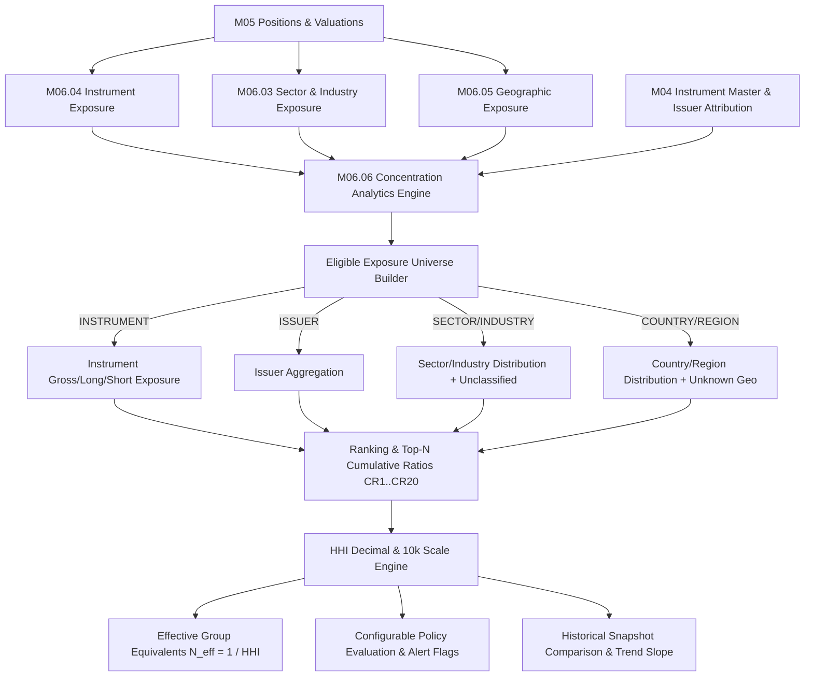

# M06.06 Concentration Analytics Architecture

## 1. Overview
The **Concentration Analytics Engine (M06.06)** is a quantitative risk management module within the Institutional Portfolio Risk Dashboard. It calculates the extent to which portfolio exposure is concentrated in a small number of instruments, issuers, sectors, industries, countries, or regions. It computes top-N cumulative concentration ratios ($CR_k$), the Herfindahl-Hirschman Index (HHI) on both decimal and 10,000-point scales, the effective number of equally weighted groups ($N_{\text{effective}} = 1 / \text{HHI}$), and tracks concentration trends over time.

## 2. Mathematical Formulations

### 2.1 Exposure Shares
For group $i$ and selected exposure basis (Gross, Long, Short, or Absolute Net):
$$w_i = \frac{E_i}{E_{\text{total}}}, \quad \sum_{i=1}^n w_i = 1$$

### 2.2 Concentration Ratios ($CR_k$)
$$CR_k = \sum_{i=1}^k w_{(i)}$$
where $w_{(1)} \ge w_{(2)} \ge \dots \ge w_{(n)}$ are descending sorted exposure shares.

### 2.3 Herfindahl-Hirschman Index (HHI)
$$\text{HHI}_{\text{decimal}} = \sum_{i=1}^n w_i^2$$
$$\text{HHI}_{10000} = \text{HHI}_{\text{decimal}} \times 10{,}000$$

### 2.4 Effective Number of Equally Weighted Groups
$$N_{\text{effective}} = \frac{1}{\text{HHI}_{\text{decimal}}}$$

### 2.5 Long-Short Treatment
- **Gross HHI**: $w_i^G = G_i / G_{\text{portfolio}}$ (Hedging does not artificially reduce measured gross concentration).
- **Long HHI**: $w_i^L = L_i / L_{\text{portfolio}}$ (Evaluated strictly on positive long exposure universe).
- **Short HHI**: $w_i^S = |S_i| / S_{\text{portfolio}}$ (Evaluated strictly on absolute short exposure universe).
- Signed net weights are **never** used in standard HHI calculations.

## 3. Precision & Invariants
- All computations use Python `Decimal` and PostgreSQL `NUMERIC(18, 6)` with `ROUND_HALF_UP`.
- Floating point arithmetic is prohibited.
- Unclassified sectors and unknown geographic distributions are explicitly retained in the concentration universe.

