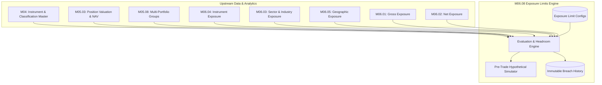

# M06.08 — Exposure Limits: Architecture Specification

## 1. Executive Summary

Module **M06.08 Exposure Limits** serves as the authoritative risk-control and governance engine of the Institutional Portfolio Risk Dashboard. It evaluates measured portfolio exposures against configured regulatory, mandate, concentration, and risk thresholds across multiple dimensions (single instruments, sectors, industries, portfolio gross and net aggregates, countries, and geographic regions).

The module enforces strict auditability:
- **Pure Determinism:** 100% `Decimal` and `NUMERIC(18, 6)` arithmetic; floating point numbers are strictly forbidden.
- **Fail-Safe Integrity:** Incomplete data, missing denominator values (NAV/gross exposure), or unmapped assets are **never** treated as passing limits (`WITHIN_LIMIT`). They are strictly surfaced as `EVALUATION_UNAVAILABLE` or `INCOMPLETE_DATA`.
- **Immutable Breach History:** Every state transition (`NEW_BREACH`, `BREACH_WORSENED`, `BREACH_RESOLVED`, `NEW_WARNING`, `WARNING_RESOLVED`) is preserved in an audit-grade event ledger.
- **Hypothetical Pre-Trade Simulation:** Enables risk managers to evaluate proposed exposure shifts against active limits without mutating the canonical portfolio book.

---

## 2. Integration Architecture

M06.08 consumes authoritative exposure calculations and reference data across upstream modules without creating duplicate position ledgers or pricing pipelines:

---

## 3. Limit Categories & Denominator Bases

### Limit Categories
- `INSTRUMENT_LIMIT`: Single-name caps/floors evaluated on long, short, net, absolute net, or gross market values.
- `SECTOR_LIMIT` & `INDUSTRY_LIMIT`: Sector and industry concentration ceilings consuming M06.03.
- `PORTFOLIO_GROSS_LIMIT`: Overall fund leverage and gross exposure constraints consuming M06.01.
- `PORTFOLIO_NET_LIMIT`: Directional exposure constraints consuming M06.02.
- `COUNTRY_LIMIT` & `REGION_LIMIT`: Geographic sovereign and regional risk constraints consuming M06.05.

### Denominator Types & Precision
1. `ABSOLUTE_AMOUNT`: Exposure measured directly in reporting currency against nominal limit value.
2. `PORTFOLIO_NAV`: Exposure expressed as a fraction or percentage of total portfolio NAV.
3. `PORTFOLIO_GROSS_EXPOSURE`: Exposure measured relative to total gross market value.
4. `PORTFOLIO_LONG_EXPOSURE`: Exposure measured relative to total long exposure.
5. `PORTFOLIO_SHORT_EXPOSURE`: Exposure measured relative to total short exposure.

### Utilization & Headroom Formulations
$$\text{Utilization \%} = \left(\frac{\text{Measured Exposure}}{\text{Limit Value}}\right) \times 100$$
$$\text{Headroom} = \text{Limit Value} - \text{Measured Exposure}$$
$$\text{Shortfall} = \text{Measured Exposure} - \text{Limit Value}$$

### Thresholds & Status Hierarchy
- `util_ratio >= severe_breach_threshold_ratio` $\rightarrow$ `SEVERELY_BREACHED`
- `util_ratio > 1.0` $\rightarrow$ `BREACHED`
- `util_ratio >= warning_threshold_ratio` $\rightarrow$ `WARNING`
- `util_ratio >= (warning_threshold_ratio * 0.90)` $\rightarrow$ `APPROACHING_LIMIT`
- `util_ratio < warning_threshold` $\rightarrow$ `WITHIN_LIMIT`
- `limit_value == 0` and `measured_exp > 0` $\rightarrow$ `ZERO_LIMIT_BREACH`
- Missing Denominator / Unresolved Data $\rightarrow$ `EVALUATION_UNAVAILABLE` (Never passing!)

