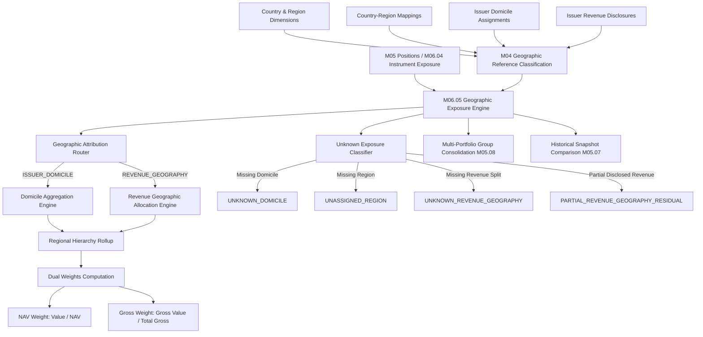

# M06.05 Geographic Exposure Architecture

## Overview
The **Geographic Exposure Engine (M06.05)** is an institutional-grade risk management module within the Institutional Portfolio Risk Dashboard. It measures, aggregates, and attributes portfolio market exposures across countries and regions under configurable classification taxonomies and multiple geographic attribution perspectives.

## Attribution Perspectives
1. **Issuer Domicile (`ISSUER_DOMICILE`)**:
   - 100% of an instrument's gross/long/short exposure is attributed to the legal country of incorporation or economic domicile of the underlying issuer.
2. **Revenue Geography (`REVENUE_GEOGRAPHY`)**:
   - Decomposes the instrument's exposure according to disclosed issuer revenue percentages across geographic countries or regions.
   - Any unallocated revenue percentage is explicitly captured as `PARTIAL_REVENUE_GEOGRAPHY_RESIDUAL`.
   - If no revenue disclosure is found, 100% of the instrument's exposure is routed to `UNKNOWN_REVENUE_GEOGRAPHY`.

## Regional Rollups
- Hierarchically aggregates country exposures into parent regions and macro-regions without double counting:
  - Country Level ($L_c, S_c, G_c, N_c$)
  - Region Level ($L_r = \sum_{c \in r} L_c$)
  - Macro-Region / Global Level

## Mathematical Specifications
- **Long Exposure ($L_g$)**: $\sum_{i \in g} V_i^+$
- **Short Exposure ($S_g$)**: $\sum_{i \in g} |V_i^-|$
- **Gross Exposure ($G_g$)**: $L_g + S_g$
- **Net Exposure ($N_g$)**: $L_g - S_g$
- **Dual Weights**:
  - **NAV Weight**: $W_{\text{NAV}, g} = \frac{N_g}{\text{NAV}}$ (or $G_g / \text{NAV}$)
  - **Gross Contribution Weight**: $W_{G, g} = \frac{G_g}{G_{\text{total}}}$
- **All arithmetic utilizes `Decimal` with strict `ROUND_HALF_UP` and 6 decimal places (`NUMERIC(18, 6)`). Floating point operations are strictly prohibited.**
