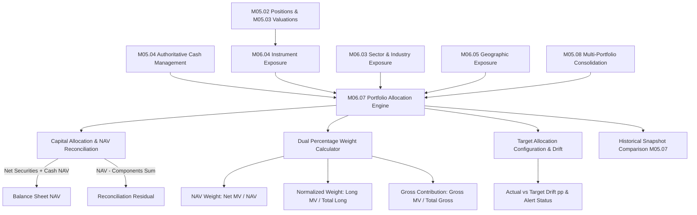

# M06.07 Portfolio Allocation Architecture

## 1. Overview
The **Portfolio Allocation Engine (M06.07)** is an institutional-grade portfolio risk and accounting layer within the Institutional Portfolio Risk Dashboard. It calculates how portfolio capital is distributed across marked securities, cash balances, sectors, countries, and strategies using an explicitly declared NAV denominator. It reconciles balance-sheet components, computes normalized and gross weights, evaluates target allocation drift, and compares allocation changes against historical snapshots.

## 2. Core Methodologies and Accounting Formulas

### 2.1 Balance Sheet NAV Decomposition
$$\text{NAV}_P = \text{Net Security Value} + \text{Cash NAV} + \text{Other NAV Components}$$
where:
$$\text{Net Security Value} = \sum_{i} L_i - \sum_{i} S_i$$
$$\text{Gross Security Exposure} = \sum_{i} L_i + \sum_{i} S_i$$

### 2.2 Dual Allocation Weights
- **NAV-Based Weight**:
  $$W_{i, \text{NAV}} = \frac{\text{Net MV}_i}{\text{NAV}_P}$$
  *(For short positions, retains signed negative weight $-S_i / \text{NAV}_P$)*
- **Normalized Invested Weight**:
  $$W_{i, \text{Invested}} = \frac{L_i}{\sum_j L_j}$$
- **Gross Exposure Weight**:
  $$W_{i, \text{Gross}} = \frac{G_i}{\sum_j G_j}$$
- **Cash NAV Weight**:
  $$W_{\text{Cash, NAV}} = \frac{\text{Cash NAV}}{\text{NAV}_P}$$

### 2.3 Allocation Drift
$$\text{Drift}_i^{pp} = \text{Actual Weight}_i - \text{Target Weight}_i$$
- Categorized as `WITHIN_TARGET`, `OVERWEIGHT`, `UNDERWEIGHT`, `MATERIAL_DRIFT`, or `UNPLANNED_ALLOCATION`.

## 3. Financial Precision & Integrity
- Computations use pure Python `Decimal` and PostgreSQL `NUMERIC(18, 6)` with `ROUND_HALF_UP`.
- Floating point arithmetic is prohibited.
- Integrates with M05.04 cash ledger without creating duplicate cash or valuation records.
